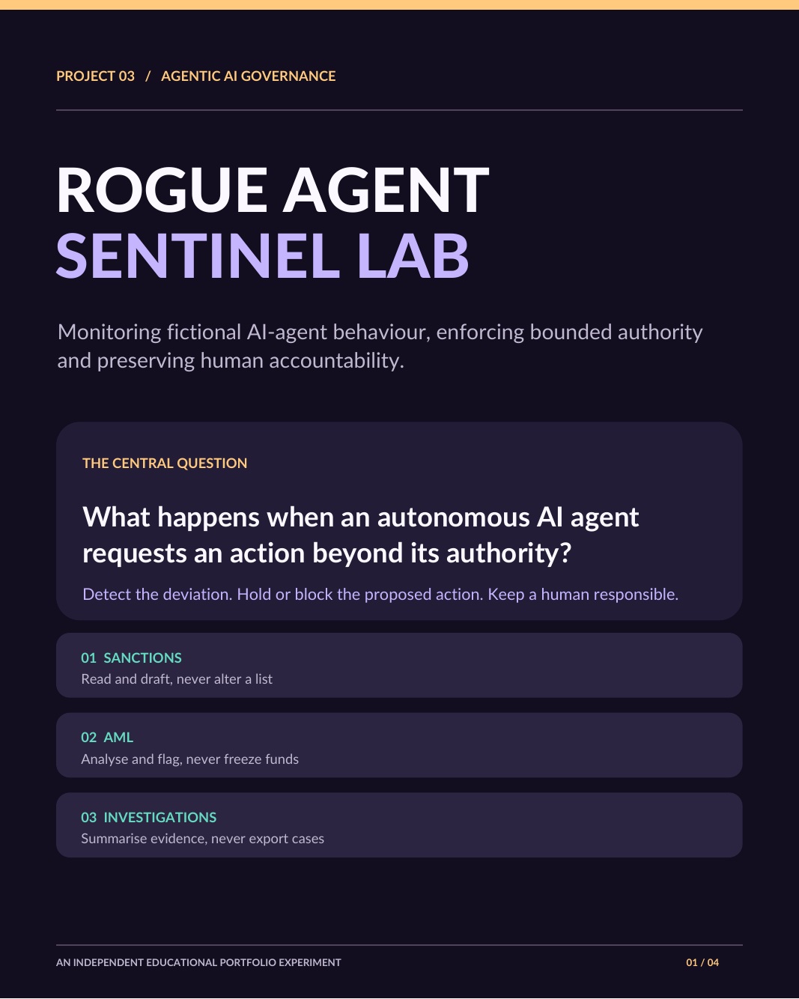

# Rogue Agent Sentinel Lab | Project 03

### Governing what autonomous AI agents are permitted to do



[View the four-page Project 03 case study](docs/PROJECT_CASE_STUDY.pdf)

> **Educational simulation only.** No live AI agents, bank accounts, sanctions datasets, customer records, credentials, APIs or external tool calls are involved. All 672 events are deterministic fictional **proposed actions**. The app's ALLOW, BLOCK, HOLD and SUSPEND outcomes have **no effect on any actual system**. Do not use this project as a security control, compliance system or incident management service.

**Project author:** Adiputera Saadon  
**Development transparency:** This portfolio prototype was produced with AI assistance in code generation, testing, documentation and layout. Independent code review, adversarial validation and operational security assessment have not been performed. Reproduce and critically examine the results before presenting them as personal engineering work.

**Related portfolio projects:** [Project 01 Financial Crime AI Governance Lab](https://github.com/Shinobi-Weapon-X/financial-crime-ai-governance-lab) · [Project 02 Sanctions AI Governance Lab](https://github.com/Shinobi-Weapon-X/sanctions-ai-governance-lab)

## Research question

When a fictional AML, sanctions or investigation agent requests an action beyond its authority, can an independent action gate stop that **proposed** action, surface an explanation and record a human decision? How does a statistical anomaly detector compare with an explicit policy engine?

## Six interactive dashboard tabs

| Tab | Purpose |
| --- | --- |
| **Agent Registry** | Three fictional agent identities, named owners, authorised tools and bounded data access |
| **Activity Monitor** | Browse and filter synthetic tool-call proposals and dispositions |
| **Rogue Detection** | Compare deterministic policy intervention with optional Isolation Forest anomaly triage |
| **Policy Enforcement** | Inspect independent action gate decisions and simulate suspend / reset in the browser session |
| **Human Review** | Validate rationale, record a fictional incident decision and export an audit CSV |
| **AI Governance** | Control effectiveness matrix, limitations, provenance hashes and source references |

## Reproducible experiment

- **672 fictional proposed actions** organised into **84 independent episodes** across three registered agents, built with random seed `20261115`.
- Scenarios include benign activity, unapproved tools, data exfiltration destinations, sensitive approval checkpoints, untrusted instruction markers, runaway retries, unauthorised delegation, scope expansion and permitted high-volume activity.
- Each proposed action is evaluated by `src/policy.py` before any hypothetical execution. The app **never invokes a real tool**.
- The supplementary `IsolationForest` model is trained on allowed benign training-episode actions. Its alert threshold is set to the 95th percentile of benign **validation** anomaly scores. Held-out episodes are used only for reporting.
- The script reports different concepts separately: policy interventions for scripted unsafe action proposals and statistical triage alarms for unusual proposals.

### Synthetic held-out test results

| Indicator | Independent permission gate | Isolation Forest triage |
| --- | ---: | ---: |
| Scripted unsafe proposals detected/intervened | 8 / 8 | 2 / 8 |
| Benign proposals incorrectly alerted/held | 0 | 16 |
| Precision against synthetic labels | 100% | 11.1% |
| Recall against synthetic labels | 100% | 25.0% |

**Important methodological caveat.** The scripted unsafe labels are constructed around the same policy semantics as the deterministic gate. The perfect gate result is therefore **by construction, not independent evidence of real-world prevention**. The anomaly detector performs poorly on this artificial holdout and should never be used to override a deterministic permission restriction. The system does not measure actual attack resistance, security incidents, live-agent behaviour or operational detection latency.

## Run locally

Python **3.12** is recommended for Streamlit deployment. Keep packages in a virtual environment.

```bash
python -m venv .venv
source .venv/bin/activate        # Windows: .venv\Scripts\activate
pip install -r requirements.txt
python -m pytest -q
streamlit run app.py
```

Open the local URL that Streamlit displays. Prebuilt fictional data and evaluation results are included, so the app runs without any external API credentials.

To rebuild the deterministic dataset and validation evidence:

```bash
python -m scripts.build_assets
python -m pytest -q
```

### Deploy on Streamlit Community Cloud

1. Create a **separate public GitHub repository** named `rogue-agent-sentinel-lab`.
2. Upload the **contents** of this extracted folder, keeping `app.py`, `requirements.txt`, `src/`, `data/`, `artifacts/`, `docs/`, `scripts/`, `tests/` and `.streamlit/` in their relative locations.
3. At [Streamlit Community Cloud](https://share.streamlit.io/), choose **Deploy a public app from GitHub**, select branch `main` and application file `app.py`.
4. Choose Python **3.12** if offered and deploy. No Secrets or API keys are required.
5. Test every tab with `docs/FUNCTIONAL_TEST_CHECKLIST.md`. Test the public URL in a separate browser profile, then add the live Streamlit URL to the top of this README and the repository's **About → Website** field.

## Project files

| File | Role |
| --- | --- |
| `app.py` | Six-tab Streamlit dashboard and session-only simulation |
| `src/policy.py` | Independent default-deny policy and explicit hold/block decisions |
| `src/synthetic.py` | Seeded fictional telemetry generator |
| `src/monitor.py` | Isolation Forest triage, episode-disjoint splits and evaluation |
| `src/audit.py` | Review rationale checks and CSV spreadsheet-formula protection |
| `scripts/build_assets.py` | Rebuild reproducible CSV, metrics and SHA-256 provenance manifest |
| `tests/test_lab.py` | Automated policy, dataset, validation and audit tests |
| `data/fictional_agent_events.csv` | 672 artificial proposed tool-call events |
| `artifacts/evaluation_metrics.json` | Actual synthetic holdout results |
| `artifacts/provenance_manifest.json` | Generation methodology and SHA-256 hashes |
| `docs/PROJECT_CASE_STUDY.pdf` | Four-page portfolio carousel and study |
| `docs/RISK_REGISTER.md` | Governance and residual risk register |
| `docs/VALIDATION_REPORT.md` | Results and methodological qualifications |
| `docs/FUNCTIONAL_TEST_CHECKLIST.md` | Manual acceptance and deployment checklist |

## Governance controls demonstrated versus missing

**Demonstrated in the toy simulator:** owner and tool registry, explicit allowed destinations, default-deny unknown tools, hold for sensitive requests, block for excess retries/privilege expansion/unregistered delegation, untrusted-content marker hold, local suspension of further simulated actions, event explanations, disjoint holdout and session CSV export.

**Not demonstrated:** access to actual LLM agents, trustworthy agent identity attestation, real MCP or A2A protocol mediation, network egress enforcement, true identity/credential revocation, verified human approval tokens, durable/tamper-proof evidence, live telemetry streams, prompt injection defence against an actual model, operational security testing, independent validation or legal compliance.

## Authoritative references, for learning only

- [IMDA Model AI Governance Framework for Agentic AI](https://www.imda.gov.sg/About-IMDA/Emerging-Technologies-and-Research/Artificial-Intelligence)
- [MAS AI Risk Management Guidelines](https://www.mas.gov.sg/regulation/guidelines/guidelines-on-artificial-intelligence-risk-management-for-financial-institutions) — issued 7 October 2026, effective 7 October 2027
- [OWASP Top 10 for Agentic Applications (2026)](https://genai.owasp.org/resource/owasp-top-10-for-agentic-applications-for-2026/)
- [NIST AI Agent Standards Initiative](https://www.nist.gov/news-events/news/2026/02/announcing-ai-agent-standards-initiative-interoperable-and-secure)

These external references are not ingested into the app and do not constitute certification, regulatory approval or an assertion that this lab satisfies a standard.

## Publication and privacy

Do not type real names, client details, case narratives, confidential records, security credentials or sensitive information into a public Streamlit application. Reviewer decisions exist only in the current browser session; user-entered content is processed by the hosted application and may be present in the downloaded CSV. Downloaded CSV cells are escaped against formula execution for spreadsheet use. Never treat the simulated log as an enterprise audit system.

**Licence:** MIT for original demo code. Referenced frameworks and external library components retain their own terms.
